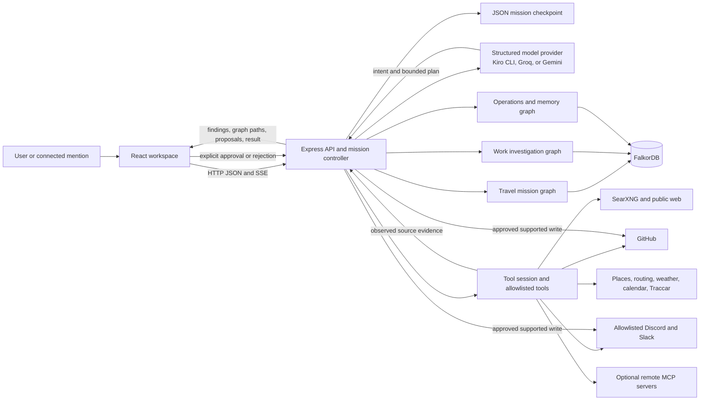
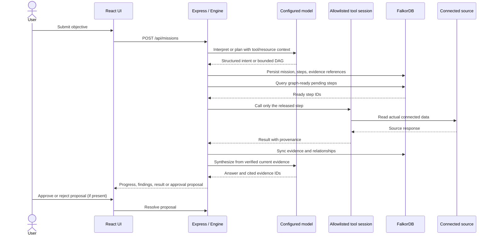
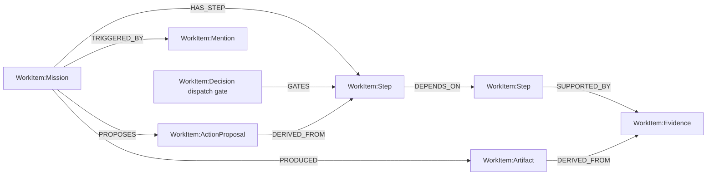

# MOVA — Agentic Investigations on Connected Data

**MOVA turns a request into a traceable investigation across connected sources.** It gathers real evidence, records how that evidence relates to decisions and actions in FalkorDB, and presents a result with source references. External write operations are prepared as proposals and require explicit approval.

> **Project status:** MOVA is a local, single-user prototype. The repository does not claim production multi-user isolation, a transactional workflow engine, or automatic execution of unapproved external actions.

## Contents

- [What MOVA does](#what-mova-does)
- [Architecture](#architecture)
- [FalkorDB and graph schemas](#falkordb-and-graph-schemas)
- [Cypher retrieval](#cypher-retrieval)
- [Investigation logic](#investigation-logic)
- [Implementation and API](#implementation-and-api)
- [Technology stack](#technology-stack)
- [Setup](#setup)
- [Configuration reference](#configuration-reference)
- [Testing and validation](#testing-and-validation)
- [Example investigation](#example-investigation)
- [Troubleshooting](#troubleshooting)
- [Current limits and future work](#current-limits-and-future-work)

## What MOVA does

Traditional chat interfaces mainly return text, while simple workflow tools usually execute a fixed sequence. MOVA combines model-guided planning with tool execution controlled by evidence and dependencies. It can read connected sources, show what it found, prepare a local deliverable, and make proposed external actions reviewable. The model can suggest a plan; it cannot directly invoke connectors or bypass the execution policy.

The implemented mission types include public-web research, GitHub repository and issue investigation, allowlisted Slack and Discord context, calendar reads, weather lookups, nearby-place searches, and travel planning. Exact capabilities depend on configured credentials and connected services. For supported GitHub, Slack, and Discord writes, MOVA produces a proposal card; a user approves or rejects it in the UI before the connector performs the write.

### Main objectives

- Ground outcomes in evidence returned by actual connected tools.
- Preserve source, timestamp, evidence class, and relationships for inspection.
- Run a bounded work plan only when its dependency steps have completed with suitable evidence.
- Make external side effects visible and approval-gated.
- Recover from some interruptions and tool failures without claiming unverified success.

## Architecture



**Request lifecycle:** the browser submits a mission to `/api/missions`. The controller either interprets a travel/read request or starts a work investigation. For work, the configured model returns a bounded structured plan from the available tool catalog and connected resources. MOVA persists the plan and evidence graph, asks FalkorDB which pending step is graph-ready, then invokes that tool through a restricted session. Findings and state changes are checkpointed and streamed to the browser. Synthesis must cite current evidence IDs; requested artifact writes are read back before being marked verified. External connector writes remain proposals until approval.



The diagrams describe code paths present in this checkout. A model output is not itself evidence; source reads, graph query results, persisted readbacks, and connector receipts are recorded separately.

## FalkorDB and graph schemas

### Why FalkorDB is used

[FalkorDB](https://docs.falkordb.com/) is a property graph database that accepts OpenCypher-compatible graph queries. MOVA uses a graph because mission context is relational: a step depends on other steps, evidence supports steps, proposals derive from evidence-backed steps, and observations can affect route dependencies. Those relationships can be traversed and shown directly. FalkorDB is a required runtime dependency for live mission investigations; this project does not silently substitute an in-memory graph engine. See the [FalkorDB Cypher reference](https://docs.falkordb.com/cypher/).

MOVA connects using the `falkordb` Node client and `FALKORDB_URL`. Reads use `roQuery`; writes use `query`. Query parameters are passed separately from Cypher text, and graph queries have a 1,000 ms timeout in the graph modules. Docker Compose binds FalkorDB to loopback port `6380`, stores database files in the named volume `mova-graph`, and enables append-only persistence plus a periodic save.

Three separately named graph families are implemented:

| Graph | Name | Purpose |
| --- | --- | --- |
| Travel mission | `mova_mission_<mission-id>` | Route candidates, constraints, observations, decisions, approvals, and action receipts. |
| Work investigation | `mova_work_<mission-id>` | Evidence-constrained tool-plan dispatch, evidence, artifacts, action proposals, and trigger mentions. |
| Workspace operations | `mova_operations` | Cross-mission memory, connected resource scope, customer reports/incidents, repository file dependencies, and related issue receipts. |

### Work investigation schema

This is the primary evidence and dependency graph used by the connected-data work agent. Each persisted node has the generic `WorkItem` label and a type label. Node fields include `id`, JSON `payload`, `status`, `evidenceKind`, and (for steps) `stepId` and `ordinal`. The payload contains the source, timestamp, explanatory label, and type-specific properties.

| Type label | Meaning / representative properties |
| --- | --- |
| `Mission` | Mission goal/state; `ready` is a graph synchronization gate. The mission node also carries `WorkItem`. |
| `Mention` | Verified connected-app trigger metadata and message content. |
| `Decision` | Graph dispatch rule and model decision metadata. |
| `Step` | Planned tool, args, status, ordinal, dependencies, and summary. |
| `Evidence` | Source ID, summary, source URL where provided, evidence class, and observation time. |
| `Artifact` | Local artifact content, evidence source IDs, and readback verification time. |
| `ActionProposal` | Proposed external operation, destination, draft summary, and approval status. |

Implemented relationship types are `HAS_STEP`, `DEPENDS_ON`, `SUPPORTED_BY`, `DERIVED_FROM`, `PRODUCED`, `PROPOSES`, `TRIGGERED_BY`, and `GATES`.



### Travel mission schema

The travel graph stores nodes under the `Item` label with a `type` property. Common fields are `id`, `type`, `label`, serialized `payload`, `active`, and `blocked`. Actual node types include `Mission`, `Place`, `Constraint`, `RouteOption`, `Entity`, `Capability`, `Observation`, `Permission`, `Decision`, and `ActionReceipt`. The graph module permits these relationship labels: `TARGETS`, `CONSTRAINS`, `CONSIDERS`, `USES`, `DEPENDS_ON`, `AFFECTS`, `EXECUTED`, `VERIFIED_BY`, `SUPPORTED_BY`, `SELECTS`, and `AUTHORIZES`.

This graph is used for travel feasibility, route dependency checks, observation impact, navigation approval evidence, and action/verification receipts. It is not the work agent’s step-dispatch graph.

### Workspace operations schema

The operations graph uses these node labels in code: `AgentMemory`, `WorkflowTemplate`, `ConnectedResource`, `MemoryEvidence`, `CustomerReport`, `Incident`, `GitHubIssue`, `ActionReceipt`, `Repository`, and `RepositoryFile`. Relationship types written or queried include `RUN_OF`, `IN_RESOURCE_SCOPE`, `SUPPORTED_BY`, `REPORTS`, `TRACKED_BY`, `CREATED_BY`, `NOTIFIED_BY`, `CONTAINS`, and `IMPORTS`.

This graph supports scoped memory recall, matching customer reports to recorded issue receipts, repository import blast-radius analysis, and visible workspace graph snapshots. If FalkorDB is unavailable some operations graph writes/reads can remain process-local; this is not a general fallback for mission execution. In contrast, live work and travel missions require FalkorDB.

### Initialization, persistence, and inspection

`server/graph.mjs` and `server/work-graph.mjs` create a label/property index on `id` if `CALL db.indexes()` returns no index records in that graph. `server/operations-graph.mjs` attempts indexes for several labels during initialization and tolerates index creation errors. Work graph writes synchronize a bounded mission snapshot: the mission is marked not ready, nodes are merged with a new revision, obsolete nodes/edges are removed, relationships are recreated, and the mission is marked ready only at the end. A per-graph in-process queue serializes these writes.

FalkorDB’s named graph data persists in the Docker volume. Mission checkpoint JSON and local artifacts are in `MOVA_DATA_DIR` (default `.data`); the volume and JSON checkpoint are distinct stores. They are not one cross-store transaction, so MOVA documents cross-store crash recovery and multi-worker consistency as remaining work.

Useful checks:

```sh
docker compose ps
curl -s http://127.0.0.1:3001/api/health
docker compose exec falkordb redis-cli GRAPH.LIST
```

The health endpoint reports API availability, FalkorDB connection state, and model configuration state. `GRAPH.LIST` shows graph names, not whether every individual graph has expected content. To inspect a specific graph, use the FalkorDB client or `redis-cli GRAPH.QUERY <graph-name> "MATCH (n) RETURN labels(n), n.id LIMIT 20"`.

## Cypher retrieval

MOVA’s Cypher is explicit, bounded, and parameterized. The model proposes work plans, but it does not generate executable Cypher for dispatch. `READY_QUERY` in `server/work-graph.mjs` releases only pending steps connected to a ready mission and verifies completed dependencies have acceptable attached evidence kinds (`observed`, `user-provided`, or `calculated_estimate`).

The relevant query in simplified formatting is:

```cypher
MATCH (m:WorkItem:Mission {id:$missionNodeId, ready:true})-[:HAS_STEP]->(s:Step {status:'pending'})
OPTIONAL MATCH (s)-[:DEPENDS_ON*1..6]->(d:Step)
OPTIONAL MATCH (d)-[:SUPPORTED_BY]->(e:Evidence)
WITH s, count(DISTINCT d) AS dependencyCount,
     count(DISTINCT CASE
       WHEN d.status='completed'
        AND e.evidenceKind IN ['observed','user-provided','calculated_estimate']
       THEN d END) AS supportedCompleteCount
WHERE dependencyCount=supportedCompleteCount
RETURN s.stepId AS stepId ORDER BY s.ordinal LIMIT 12
```

Line by line:

1. `MATCH` anchors traversal to a mission whose synchronization flag is `ready:true`, then finds its pending steps.
2. `OPTIONAL MATCH` follows each step’s dependency chain for one to six hops. A source step with no dependencies remains eligible.
3. The second optional match finds evidence supporting each dependency step.
4. `WITH` counts distinct dependencies and the subset that completed with an allowed evidence kind.
5. `WHERE` permits a step only if the counts match. A failed or unsupported dependency therefore prevents dispatch.
6. `RETURN` emits step IDs in the plan’s ordinal order, capped at 12 results.

The exact source query currently returns only pending steps, ordered by `ordinal`, with a 12-step result cap. A plan is separately limited to seven steps by validation. The path depth cap is six.

For source lineage and evidence inspection, `readSnapshot()` first matches a ready mission, then retrieves node payloads and relationship payloads. One actual-style inspection query is:

```cypher
MATCH (:WorkItem:Mission {id:$id,ready:true})
MATCH (n:WorkItem)
RETURN n.payload AS payload, n.status AS status, n.evidenceKind AS evidenceKind
LIMIT 141
```

`$id` is passed as a parameter (`mission`), rather than interpolated into the query. The response is parsed into graph nodes and preserves the recorded evidence source, observed time, class, and relationship provenance inside `payload`.

Other graph traversals include:

- **Impact ranking** (`IMPACT_RANK_QUERY`): paths of up to eight relationship hops from the mission through steps, evidence, gate/derived/action relationships. It calculates nearest hop, path count, and neighboring relationship degree, then returns up to 20 records. This is a query-derived ranking, not a general-purpose graph centrality algorithm.
- **Repository blast radius** (`blastRadiusQuery`): follows `IMPORTS` paths up to eight hops to find indexed files that depend on a changed source file. The code first builds import links from relative source imports in a complete bounded repository snapshot. A bounded in-memory breadth-first traversal is used if graph query rows are unavailable but the complete snapshot is in memory.
- **Travel feasibility and impact** (`CANDIDATE_QUERY`, `DEPENDENCY_QUERY`, `IMPACT_QUERY`): match active route options through `USES`/`DEPENDS_ON`, observations through `AFFECTS`, and mission constraint paths. Results are limited to 100; query timeout is one second.
- **Related incident lookup** (`relatedQuery`): matches an exact repository/fingerprint chain from a customer report to a recorded GitHub issue.

Cypher’s `MATCH`, `OPTIONAL MATCH`, `WITH`, `WHERE`, `RETURN`, `MERGE`, `UNWIND`, `SET`, and deletion clauses appear in the actual graph modules. `MERGE` makes repeated writes keyed by stable node/edge IDs idempotent within the graph; it does not make arbitrary external API actions idempotent by itself. Evidence IDs are deduplicated during work execution, while stale evidence from replaced plans is retained in JSON history but excluded from the active graph. Active references to unknown step IDs are rejected instead of being represented as valid graph evidence.

For the language and command behavior, consult FalkorDB’s [Cypher documentation](https://docs.falkordb.com/cypher/) and [client libraries](https://docs.falkordb.com/getting-started/clients/). These are vendor references; the examples above describe MOVA’s own queries.

## Investigation logic

### Work-plan dispatch

The model receives the objective, configured connected resources, selected workflow limits, recent relevant context, current evidence, and a tool catalog. It returns a DAG of one to seven typed steps. Validation checks tool names, IDs, arguments, dependency references and cycles before persistence. A graph-impact analysis step may be inserted after reads when available and relevant. For unnumbered GitHub issue requests, MOVA can add searches across configured repositories before a discussion reply. It does not select an issue without a confident match in retrieved evidence.

```text
validate plan and DAG
sync plan to FalkorDB (ready=false, then ready=true after full sync)
repeat within bounded work/time budget:
    query FalkorDB for graph-ready pending steps
    if none: mark dependency-blocked steps; stop dispatch
    mark one released step running and sync graph
    invoke only that step through the allowlisted tool session
    on read failure: retry once; if it still fails, record skipped evidence and continue
    validate/deduplicate actual result evidence and attach it to the step
    sync graph before another dispatch decision
verify artifact writes by listing and comparing saved content/source IDs
synthesize only from current evidence IDs
```

The work-cycle time budget is three minutes per run, and the dispatch loop is capped at 12 rounds. Individual FalkorDB queries have a one-second timeout. Read connector calls in `work-engine.mjs` are attempted at most twice per step (initial call plus one retry); write/proposal tools are attempted once. A failed proposal draft is recorded as unavailable and does not erase a verified research answer. Those are the implemented retry limits; not every upstream provider has an automatic retry.

### Evidence validation and state

- Source results become evidence records carrying a stable ID, step ID, title, summary, source, observed timestamp, evidence kind, optional URL, and current/stale flag.
- Duplicate evidence IDs are collapsed. If a duplicate points to another step, the graph validator rejects that active conflict. Stale records are retained outside the current graph; artifacts whose source IDs are no longer current are marked stale.
- Artifact creation is a local write and is verified by reading the artifact back and comparing content and source IDs.
- External writes are represented by `ActionProposal` records in `PENDING_APPROVAL`. Approval is revision-bound and executed once through the relevant connector. Connector confirmation is recorded as `VERIFIED`; uncertain outcomes remain `UNKNOWN` and are not silently retried.
- Work investigations transition through states such as `MISSION_CREATED`, `PLANNING`, `EXECUTING`, `VERIFYING`, `BLOCKED`, and `RESOLVED`. A restart converts interrupted in-flight work to a resumable blocked state and resets only safe in-flight tool steps. An interrupted external action becomes unknown until reconciled.
- A model may ask at most one essential user-input question for a work mission. If sources fail or no exact target is found, MOVA records the limitation and synthesizes the best evidence-backed alternative when current evidence exists.

The UI exposes Agent, Workflows, Connections, Live execution, Graph impact, and History views. Active mission progress is delivered over Server-Sent Events. The local checkpoint is JSON, while graph snapshots and evidence paths are read from FalkorDB.

## Implementation and API

### Main components

| Path | Responsibility |
| --- | --- |
| `src/App.tsx` | Workspace navigation, mission composer, progress/result view, approval dialogs, and state streaming. |
| `src/components/` | Connections, work evidence/actions/artifacts, map views, execution trace, workflows, and graph visualizations. |
| `src/location.mjs` | Browser geolocation request and location permission integration. |
| `server/index.mjs` | Express setup, local security boundaries, dependency wiring, polling, API routes, and SSE endpoint. |
| `server/engine.mjs` | Mission creation, travel/read orchestration, route graph evaluation, location updates, and state transitions. |
| `server/work-engine.mjs` | Structured work-plan validation, dependency-ready dispatch, evidence handling, synthesis, proposal approvals, and recovery behavior. |
| `server/work-tools.mjs` | Tool catalog and implementations for web, GitHub, Slack, Discord, local artifacts, calendar, and supported proposals. |
| `server/graph.mjs` | Travel mission graph and route/dependency/impact queries. |
| `server/work-graph.mjs` | Work mission graph serialization, readiness traversal, snapshot, and impact analysis. |
| `server/operations-graph.mjs` | Workspace memory, report/issue association, repository import graph, and blast radius. |
| `server/provider.mjs` | Intent/planning/synthesis/draft model interface; isolates Kiro CLI or sends structured API requests to Groq/Gemini. |
| `server/adapters.mjs` | Places, route, weather, calendar OAuth/API, voice, and Firebase adapter functions. |
| `server/connectors.mjs` | Connection metadata and active service probes. |
| `server/store.mjs` | Serialized local JSON mission checkpoint reads/writes. |
| `server/remote-mcp.mjs`, `server/mcp.mjs` | Optional remote MCP client and local MCP stdio server. |
| `server/tool-session.mjs` | Restricts model-planned calls to an allowlisted tool catalog and validates arguments. |
| `server/traccar.mjs`, `server/geo.mjs` | Device fix validation and geographic calculations. |
| `server/workflows.mjs`, `server/resource-registry.mjs` | Workflow definitions and configured resource selection. |
| `docker-compose*.yml`, `config/` | FalkorDB, optional SearXNG and Traccar services and their configuration. |
| `tests/` | Node test-runner unit/contract tests for graph, work, integrations, storage, and mission behavior. |

### HTTP API routes

The backend routes are registered in `server/index.mjs`:

| Method and path | Purpose |
| --- | --- |
| `GET /api/health`, `/api/state`, `/api/events` | Health, current state, and SSE state updates. |
| `GET /api/connectors`; `POST /api/connectors/:id/check`, `/configure` | Connector state, probe, and configuration. |
| `GET /api/capabilities`, `/api/resources`; `PUT /api/resources/:service` | Tool capabilities and selected connected resources. |
| `GET /api/workflows`; `POST /api/workflows` | List and save workflows. |
| `POST /api/missions` | Create and start a mission. |
| `POST /api/missions/:id/select`, `/context`, `/resume`, `/observe`, `/acknowledge`, `/approve` | Select, update, resume, observe, acknowledge, or approve supported mission actions. |
| `POST /api/missions/:id/proposals/:proposalId` | Approve or reject a work-action proposal. |
| `POST /api/location`, `/api/location/manual` | Submit browser position or resolve a manually entered place. |
| `GET /api/tracking`; `POST /api/tracking/refresh`, `/control` | Read and control Traccar polling. |
| `GET /api/memory/graph` | Workspace operations graph snapshot. |
| `GET /api/google/auth`, `/api/google/callback`, `/api/calendar` | Google Calendar OAuth and authorized reads. |
| `GET /api/voices`; `POST /api/speech` | Optional voice listing and speech generation. |

The server binds to loopback by default and refuses non-loopback `HOST` values. Vite serves the web client at port `5173` and proxies `/api` to `127.0.0.1:3001` during development.

## Technology stack

| Technology | Role | Where used |
| --- | --- | --- |
| React 19, TypeScript, Vite | Interactive single-page workspace and development/build pipeline. | `src/`, `vite.config.ts`, `package.json` |
| Node.js ES modules | Backend runtime and built-in test runner. | `server/`, `tests/` |
| Express 5 | Loopback HTTP API, static production serving, and SSE. | `server/index.mjs` |
| FalkorDB and Cypher | Persistent mission graphs and graph-constrained dispatch/analysis. | `server/graph.mjs`, `server/work-graph.mjs`, `server/operations-graph.mjs` |
| Redis protocol client | Used by FalkorDB client and connector probe. | `falkordb`, `redis` dependencies |
| Kiro CLI, Groq API, Gemini API | Configurable structured model provider options. | `server/provider.mjs` |
| MCP SDK | Optional remote tools and local stdio MCP server. | `server/remote-mcp.mjs`, `server/mcp.mjs` |
| Docker Compose | Local FalkorDB; optional SearXNG and Traccar services. | `docker-compose*.yml` |
| GitHub, Discord, Slack APIs | Allowlisted source reads and explicit-approval external proposals. | `server/work-tools.mjs` |
| TomTom, OpenStreetMap/Nominatim/OSRM, Google Maps APIs | Configurable places and routing providers; maps also display route geometry. | `server/adapters.mjs`, map components |
| Open-Meteo | Public weather context. | `server/adapters.mjs` |
| Google Calendar OAuth | Authorized primary-calendar reads; write support is separately gated in adapter code. | `server/adapters.mjs` |
| Leaflet, XYFlow, Lucide React | Map, graph visualization, and icons. | `src/components/` |
| Remotion Player | Video/player dependency used by the UI project. | package dependency |
| Node `node:test`, Playwright Test dependency | Automated test framework and available browser test dependency. | `tests/`, `package.json` |

## Setup

### Prerequisites

- Node.js **20.18 or later** (the README’s supported baseline; Node 22 is also suitable).
- npm and Git.
- Docker Desktop or Docker Engine with Docker Compose v2.
- A configured model option for live investigations. The checked-in `.env.example` selects Kiro CLI; you can instead configure Groq or Gemini.
- A running FalkorDB service for missions.
- Optional credentials/services for the integrations used by a request.

### Install and start

```sh
git clone <repository-url>
cd mova
cp .env.example .env
npm install
```

Edit `.env` locally. The template is configured for Kiro CLI and TomTom; either configure those credentials and the required CLI, or select a provider/map option you have access to. Do not commit `.env`.

Start the required graph service and optional services only when needed:

```sh
# Required for live mission graphs
docker compose up -d

# Optional: self-hosted web search used by web_search
docker compose -f docker-compose.search.yml up -d

# Optional: local Traccar phone-device tracking
docker compose -f docker-compose.traccar.yml up -d
```

The default compose file exposes FalkorDB at `127.0.0.1:6380`. Search is exposed at `127.0.0.1:8181`, Traccar management/API at `127.0.0.1:8082`, and Traccar device ingress at `127.0.0.1:5055` by default.

Configure one model provider:

| `LLM_PROVIDER` | Required configuration |
| --- | --- |
| `kiro-cli` | Install and authenticate the Kiro CLI, provide `KIRO_API_KEY`, and optionally set `KIRO_CLI_PATH`/`KIRO_MODEL`. The CLI is launched with a temporary no-tools profile; MOVA executes tools itself. |
| `groq` | `GROQ_API_KEY`; optional `GROQ_MODEL`. |
| `gemini` or unset | `GEMINI_API_KEY`; optional `GEMINI_MODEL`. |

Start the application:

```sh
npm run dev
```

Open <http://127.0.0.1:5173>. The backend listens at <http://127.0.0.1:3001>. For a production frontend bundle, run `npm run build`; `npm start` then starts the backend and serves `dist/` when present.

Check service status:

```sh
docker compose ps
curl -s http://127.0.0.1:3001/api/health
curl -s http://127.0.0.1:3001/api/connectors
```

`/api/health` confirms API responsiveness and reports FalkorDB/model configuration. Use **Connections** in MOVA to run actual connector checks; a present key is not proof that provider permissions or quotas work. To confirm graph access, use the FalkorDB connector check or `docker compose exec falkordb redis-cli GRAPH.LIST`.

### Optional integrations

- **Web search:** start the SearXNG compose service. `SEARXNG_BASE_URL` or `SEARXNG_URL` may override its local endpoint. Results are leads; MOVA reads source pages for evidence.
- **GitHub:** public repository reads may work without a token. Configure `GITHUB_ALLOWED_REPOSITORIES` for restricted work scope. Mention polling and proposed writes require a token with appropriate scoped permissions. Keep only repositories you control or are authorized to access in the allowlist.
- **Discord/Slack:** configure bot tokens, explicit allowed channel IDs, bot user IDs for mention matching, and set `MOVA_GRAPH_DATA_ATTESTATION=public_or_owned` only after confirming the data may be ingested. The bot requires platform-specific message-history/content permissions. Sending remains approval-gated.
- **TomTom:** with `MAPS_PROVIDER=tomtom`, set `TOMTOM_API_KEY` and enable search/routing access for that key.
- **OpenStreetMap providers:** set `MAPS_PROVIDER=osm` to use the public Nominatim/OSRM adapters. Respect their usage policies; MOVA throttles public place lookups.
- **Google Maps:** `MAPS_PROVIDER=google` uses configured server Maps API access; browser map configuration can use the web key. Restrict keys to the necessary APIs and origins.
- **Google Calendar:** configure OAuth client and a 64-character hexadecimal `TOKEN_ENCRYPTION_KEY`, then connect using the UI. Read access requires OAuth consent. Calendar writes are not a general work-agent capability.
- **Traccar:** configure a device and read credentials, run the optional compose service, then set phone client/device values and location permissions. Tracking is only usable when a recent, valid fix is available.
- **Remote MCP:** create a local config from `config/mcp.example.json`, set `MOVA_MCP_CONFIG`, and use only trusted HTTPS servers and owner-approved read tools. Never put tokens into a committed config.

## Configuration reference

`.env.example` is the source for the template values below. Values shown are placeholders/defaults, not working credentials. **Required** means required for that feature, not for every MOVA page.

| Variable | Purpose | Requirement / safe example |
| --- | --- | --- |
| `PORT`, `HOST`, `APP_ORIGIN` | Backend port, loopback bind, accepted browser origin. | Runtime defaults `3001`, `127.0.0.1`, `http://localhost:5173`; keep `HOST` loopback. |
| `APP_SESSION_SECRET` | Session cookie signing. | Optional for local development; server generates an ephemeral value if absent. Use a private random secret for stable local sessions. |
| `MOVA_DATA_DIR` | Local JSON, OAuth token, and artifact storage directory. | Optional; `.data`. |
| `FALKORDB_URL` | FalkorDB Redis-protocol connection URL. | Required for live work/travel missions; `redis://127.0.0.1:6380`. |
| `FALKORDB_GRAPH_NAME` | Template graph-name setting. | Present in template, but graph modules currently use their own names/prefixes (`mova_mission_…`, `mova_work_…`, `mova_operations`); this variable is not read by the current implementation. |
| `LLM_PROVIDER` | Chooses model provider. | `kiro-cli`, `groq`, or `gemini`; template selects `kiro-cli`. |
| `KIRO_API_KEY`, `KIRO_MODEL`, `KIRO_CLI_PATH`, `MOVA_KIRO_TIMEOUT_MS` | Kiro CLI credentials, model, executable and timeout. | Required only for Kiro. Example model `claude-haiku-4.5`, executable `kiro-cli`, timeout `90000`. |
| `GROQ_API_KEY`, `GROQ_MODEL` | Groq structured-output provider. | Required only for Groq; template model `openai/gpt-oss-20b`. |
| `GEMINI_API_KEY`, `GEMINI_MODEL` | Gemini structured-output provider. | Required only for Gemini; model template value `gemini-3.8-flash`. |
| `MAPS_PROVIDER` | Selects `tomtom`, `osm`, or `google` adapter family. | Optional; code default is `osm`, template selects `tomtom`. |
| `TOMTOM_API_KEY` | Server-side TomTom places/routing access. | Required only for TomTom; leave blank until configured. |
| `OSRM_BASE_URL`, `NOMINATIM_BASE_URL`, `OSM_TILE_URL`, `OSM_USER_AGENT` | OpenStreetMap routing, geocoding, tiles, and request identification. | Optional public defaults shown in template. |
| `GOOGLE_MAPS_SERVER_API_KEY`, `GOOGLE_MAPS_WEB_API_KEY`, `GOOGLE_MAPS_ANDROID_API_KEY` | Google Maps server/browser/mobile key slots. | Optional; use restricted keys. Only server and web keys are consumed in current app paths; Android key is a template slot. |
| `GOOGLE_CLIENT_ID`, `GOOGLE_CLIENT_SECRET`, `GOOGLE_REDIRECT_URI` | Calendar OAuth client and callback. | Required for Calendar OAuth; local callback default is `http://localhost:3001/api/google/callback`. |
| `TOKEN_ENCRYPTION_KEY` | Encrypts saved Google OAuth tokens using AES-256-GCM. | Required for Calendar OAuth; exactly 64 hexadecimal characters. Generate locally, e.g. `openssl rand -hex 32`; never publish it. |
| `GOOGLE_CALENDAR_WRITE_ENABLED` | Additional adapter permission gate for calendar event writes. | Optional; `false` by default. No general work-agent event-write tool is advertised. |
| `SEARXNG_BASE_URL`, `SEARXNG_URL` | Self-hosted SearXNG endpoint. | Optional; configure one only if not using the local default. |
| `GITHUB_TOKEN`, `GITHUB_ALLOWED_REPOSITORIES`, `GITHUB_MENTION_HANDLE` | GitHub mention polling, repository scope, and proposal permissions. | Token optional for public reads, required for polling/writes. Example allowlist format `owner/repo,owner/other-repo`; handle `mova`. |
| `MOVA_GRAPH_DATA_ATTESTATION` | Explicit confirmation for Discord/Slack data ingestion into graph storage. | Required for chat connectors; use `public_or_owned` only when accurate. |
| `SLACK_BOT_TOKEN`, `SLACK_ALLOWED_CHANNEL_IDS`, `SLACK_BOT_USER_ID` | Slack read/mention and proposal connector settings. | Optional; bot token and channel allowlist required for channel access. |
| `DISCORD_BOT_TOKEN`, `DISCORD_ALLOWED_CHANNEL_IDS`, `DISCORD_BOT_USER_ID` | Discord read/mention and proposal connector settings. | Optional; bot token and channel allowlist required for channel access. |
| `MOVA_MENTION_POLL_SECONDS`, `MOVA_MENTION_MAX_AGE_MINUTES` | Connected mention polling interval and accepted event age. | Optional; defaults are 45 seconds and 10 minutes, bounded by code. |
| `TRACCAR_URL`, `TRACCAR_DEVICE_ID`, `TRACCAR_TOKEN`, `TRACCAR_USERNAME`, `TRACCAR_PASSWORD`, `TRACCAR_POLL_INTERVAL_MS`, `TRACCAR_INGEST_BIND` | Optional phone tracking service URL, selected numeric device, auth, polling interval and upload bind. | Device ID plus supported credentials are needed for polling. Defaults target local service and 15 seconds. Do not expose ingress beyond a trusted LAN. |
| `OPEN_METEO_BASE_URL` | Weather endpoint base URL. | Optional; template public endpoint. |
| `ELEVENLABS_API_KEY`, `ELEVENLABS_VOICE_ID` | Optional voice list and speech synthesis. | Optional; requires account key and available voice. |
| `FIREBASE_PROJECT_ID`, `FIREBASE_SERVICE_ACCOUNT_PATH` | Firebase adapter configuration. | Optional; end-to-end native push delivery is not implemented in this web prototype. |
| `MOVA_GITHUB_SNAPSHOT_MAX_FILES`, `MOVA_GITHUB_SNAPSHOT_MAX_BYTES` | Bounded repository snapshot safety limits. | Optional; inspect source defaults before increasing. |
| `CUSTOMER_ISSUE_REPOSITORY` | Repository used by customer-issue routing configuration. | Optional; use an authorized `owner/repo`. |
| `MOVA_MCP_CONFIG` | Path to remote MCP server configuration. | Optional; default config path is code-defined. Keep credentials in environment or secure local config. |
| `APP_TIMEZONE`, `ELEVENLABS_MODEL_ID` | Timezone supplied to intent interpretation; optional ElevenLabs synthesis model. | Not present in `.env.example`; optional, with code defaults. |
| `GMAIL_ENABLED`, `GOOGLE_DRIVE_ENABLED`, `LOG_LEVEL` | Template-only integration/logging switches. | Present in `.env.example` but not currently read by runtime code; setting them does not enable Gmail, Drive, or configurable logging. |

The API keys, OAuth secrets, bot tokens, and device passwords belong only in the local backend `.env`. The Vite client does not read `.env` directly, except values deliberately returned through API state (the code currently supplies the Google Maps web key to map UI when configured). Keep browser keys origin/API restricted.

## Testing and validation

Tests use Node’s built-in test runner and are under `tests/`:

```sh
npm test
npm run test:graph
npm run build
```

`npm test` runs the complete test folder. `npm run test:graph` runs the real FalkorDB graph contract test file; the real-server integration test is skipped unless `FALKORDB_TEST_URL` is set. The rest of graph/work tests use controlled test doubles and do not constitute an external-service check. `npm run build` runs `tsc -b` and then `vite build`; there is no separate lint or typecheck script in `package.json`.

For an end-to-end manual smoke run:

1. Start FalkorDB and the backend/frontend (`npm run dev`).
2. Check `GET /api/health` and **Connections**. Confirm the graph and selected model are actually available.
3. Configure GitHub and/or SearXNG if the task needs them; select authorized repositories in Connections/resources.
4. Submit a bounded request in Agent. Watch Live execution for tool calls and graph-ready steps.
5. Inspect Findings and evidence source links. For a requested local artifact, confirm it appears under Deliverables after persisted readback.
6. For an external action proposal, inspect the proposed content and destination; only approving it triggers the supported connector call.

A successful run should show real source results with timestamps/provenance, a graph snapshot with the work relationships, and either a synthesized answer with current evidence citations or a clearly explained limitation. A connection setting alone is not a successful source read.

## Example investigation

This is an **illustrative request and flow**, not a claim that a live repository was queried:

> “Review the Agents-Playground repository’s current structure and recent commits, identify the main project areas, and save a short evidence-linked summary for team review.”

1. The user submits the objective in the Agent page.
2. The configured model creates a bounded work plan using tools MOVA has actually made available.
3. MOVA validates tool names and dependency references; it can plan repository metadata/tree/commit reads and a final artifact only if requested and supported.
4. The GitHub connector reads the configured repository. GitHub responses become source evidence with URLs and observation times.
5. The work graph records `Mission`, `Step`, and `Evidence` nodes with `HAS_STEP` and `SUPPORTED_BY` relationships. The graph gate releases the next step after dependencies have qualifying evidence.
6. When relevant and within plan budget, MOVA can query FalkorDB impact relationships to produce a multi-hop impact view.
7. The model synthesizes from current evidence, and source IDs are validated against the current evidence set.
8. If the user requested an artifact, MOVA writes it locally and reads it back to compare contents/source references.
9. The mission reaches `RESOLVED` only when work completes without failed/blocked steps or pending external proposals. A required proposal remains visible and approval-gated.
10. The Agent UI displays the answer, source references, investigation trace, graph, and any action proposal.

Actual findings depend on the configured repository, credentials, provider response, and live service availability.

## Troubleshooting

| Symptom | Diagnostic | Fix |
| --- | --- | --- |
| Docker or FalkorDB is stopped | `docker compose ps`; `curl -s http://127.0.0.1:3001/api/health` | Start Docker, then `docker compose up -d`. Check Docker logs with `docker compose logs falkordb`. |
| Graph connection unavailable | `docker compose logs falkordb`; check `FALKORDB_URL` and port `6380` | Ensure URL matches Compose (`redis://127.0.0.1:6380`), no other service owns the port, and the container is healthy. Restart the backend after env changes. |
| Model is unconfigured | `GET /api/health`, Connections view, backend logs | Set the selected provider’s key. For `kiro-cli`, install/authenticate the CLI and make sure `KIRO_CLI_PATH` resolves. Check timeout/quota errors separately from missing credentials. |
| Kiro CLI times out or is missing | Backend output and Connections model check | Install CLI, verify authentication and `PATH`; adjust `MOVA_KIRO_TIMEOUT_MS` only within its supported 30–110 second range. Groq fallback is used only when configured by provider code. |
| Web search returns unavailable | `docker compose -f docker-compose.search.yml ps`; `docker compose -f docker-compose.search.yml logs search` | Start SearXNG; check its config under `config/search/` and the configured SearXNG URL. Search results are not source verification; MOVA must read pages. |
| Port is already in use | `lsof -i :3001 -i :5173 -i :6380` on macOS/Linux | Stop the conflicting service or set a different `PORT` where supported; Vite’s configured dev port is 5173 and FalkorDB Compose maps host 6380. |
| Frontend cannot reach backend | Browser network panel; `curl -i http://127.0.0.1:3001/api/health` | Run `npm run dev` from repository root; check same-origin host and `APP_ORIGIN`. Vite proxies `/api` to loopback port 3001. |
| GitHub source reads are denied/empty | Connections check; verify `GITHUB_ALLOWED_REPOSITORIES`, token scope, repository spelling and visibility | Public reads may not require a token; mention monitoring/proposals do. Grant only needed scopes and allowlist the exact repository. |
| Discord/Slack channel reads are empty | Connector check and bot logs; inspect allowed channel IDs and bot permissions | Invite the bot to the channel, grant history/content access, set bot user ID and required data attestation. Missing permission is not evidence that the channel is empty. |
| Graph readiness returns no step | Inspect mission graph and tool result/evidence status in Live execution | Check for failed/blocked dependencies, missing current `SUPPORTED_BY` evidence, stale evidence, or incomplete sync. Resume after fixing source availability; do not manually mark evidence complete. |
| Mission is blocked or pending after restart | Open the mission in Agent/History and inspect Live execution | Work recovery blocks interrupted missions and permits resume; external actions interrupted in flight become `UNKNOWN` and must be reconciled before repeating. |
| Google Calendar cannot connect | Check exact OAuth redirect URI and `TOKEN_ENCRYPTION_KEY` format | Configure Calendar API/OAuth consent, use a 64-hex-character key, reconnect if token decryption/refresh fails. |
| Place or route API returns errors | Connections check; verify `MAPS_PROVIDER`, key restrictions and enabled APIs | Match provider to credentials and enable its required API. Public OSM endpoints have usage limits; TomTom/Google key presence alone does not prove access. |
| Build or tests fail | `npm install`, `npm test`, `npm run build` | Use a supported Node version; inspect the first reported error and confirm dependencies are installed. Real FalkorDB integration tests need `FALKORDB_TEST_URL`. |

## Current limits and future work

Confirmed current limits include a single-process backend and local JSON checkpoints; work missions are capped at seven planned steps, 36 graph steps, 80 evidence entries and bounded artifact/proposal counts; graph queries and tool cycles have explicit limits; optional external services can fail or rate-limit; cross-store crash recovery and multi-worker transactional consistency are not implemented. Public web snippets are treated as leads, not verified claims. Browser support for native app notifications is not the same as end-to-end Firebase push, which is not implemented.

Potential future work (not current functionality): transactional or replayable mission persistence across JSON and FalkorDB, authenticated multi-user deployment, durable queued jobs for longer investigations, richer observability, and end-to-end native push registration/delivery verification. These are planning ideas, not delivered features.

## Closing

MOVA’s core value is an auditable path from a user objective to connected-source evidence and a verified outcome. The model helps interpret and plan; FalkorDB represents dependencies and controls which work step is ready; connectors provide external evidence; and user approval gates supported external writes. This makes both the result and its limitations inspectable by evaluators and developers.
